# RouteMate AI — Phase 5 Implementation Plan

**Objective:** Transform RouteMate AI into an audited, secure, operationally hardened, production-ready system with verified recovery, monitoring, quality gates, and launch artifacts.

---

## Architecture & Work Breakdown

```mermaid
graph TD
    A[Phase 5: Production Readiness] --> B[1. Security Hardening]
    A --> C[2. Database Concurrency & Recovery]
    A --> D[3. Frontend & Deployment Hardening]
    A --> E[4. CI/CD & Observability]
    A --> F[5. Launch & Governance Docs]

    B --> B1[OTP Brute-Force & Replay Fixes]
    B --> B2[IDOR & Data Isolation Enforcement]
    B --> B3[CORS & Production Secret Validation]
    B --> B4[Rate Limiter Expansion]

    C --> C1[SQLite WAL & Busy Timeout PRAGMAs]
    C --> C2[Active Health Check DB Ping]
    C --> C3[Automated Backup & Restore Utility]

    D --> D1[Vite Manual Chunks Code Splitting]
    D --> D2[API URL Unification]
    D --> D3[Safe .env.example Templates]

    E --> E1[Structured Production Logging]
    E --> E2[CI/CD Security Quality Gates]
    E --> E3[Phase 5 Test Suite]

    F --> F1[Deployment Guide & Runbooks]
    F --> F2[Incident Response & Launch Checklist]
```

---

## Detailed Step-by-Step Implementation Sequence

### Step 1: Security Hardening
1. **`backend/app/core/config.py`**:
   - Add `ENVIRONMENT = os.environ.get("ROUTEMATE_ENV", "development")`.
   - Add `ALLOW_DEV_OTP = os.environ.get("ROUTEMATE_ALLOW_DEV_OTP", "true" if ENVIRONMENT != "production" else "false").lower() in ("true", "1")`.
   - Update `CORS_ORIGINS` to parse `os.environ.get("ALLOWED_ORIGINS")` or sensible defaults (`localhost`, `127.0.0.1`, `adarshbandaru.github.io`). Disallow wildcard origin with credentials when in production.
   - Enforce startup validation: If `ENVIRONMENT == "production"` and `JWT_SECRET` contains default fallback string, raise an error or warn loudly.
2. **`backend/app/core/security.py`**:
   - Single-use OTP: Remove OTP from `OTP_STORE` and `OTP_BY_ID` after successful verification.
   - Attempt tracking: Track failed attempts per phone (max 5); invalidate OTP if exceeded.
   - Environment gating: Restrict `"123456"` bypass to sandbox/test phone numbers only when `ALLOW_DEV_OTP` is enabled.
3. **`backend/app/api/routes/phase3.py` & `bookings.py`**:
   - Enforce data isolation on `/v1/wallet/{user_id}/pay` and `/v1/wallet/{user_id}/topup`: verify authenticated caller matches `user_id` or has admin role.
   - Enforce ownership validation on `/v1/bookings/{booking_id}/cancel`: verify caller is the rider who booked, assigned driver, or admin.
   - Replace deprecated `.dict()` calls with `.model_dump()`.
4. **`backend/app/core/middleware.py`**:
   - Expand `RateLimiterMiddleware` sensitive paths to include `/v1/bookings/schedule`, `/v1/bookings/{id}/cancel`, `/v1/wallet/{id}/pay`, and `/v1/bookings/pool`.

### Step 2: Database Reliability, Concurrency & Recovery
1. **`backend/app/core/database.py`**:
   - In `get_connection()`: configure `PRAGMA journal_mode = WAL;`, `PRAGMA foreign_keys = ON;`, `PRAGMA busy_timeout = 5000;`.
2. **`backend/app/main.py`**:
   - Update `/health` and `/v1/health` to execute `SELECT 1` on the database with a 2-second timeout. Return HTTP 503 `{"status": "unhealthy", "error": "database unreachable"}` on error.
3. **`backend/scripts/backup_db.py`**:
   - Create automated SQLite online backup script (`sqlite3.backup()`) with timestamping, integrity checking (`PRAGMA integrity_check`), and retention pruning.
4. **`backend/scripts/restore_db.py`**:
   - Create safe restoration verification script with prerequisite validation and dry-run testing.

### Step 3: Frontend & Deployment Optimization
1. **`dashboard/vite.config.js`**:
   - Add Rollup `output.manualChunks` splitting (`vendor`, `leaflet`, `lucide`) to reduce bundle chunk size below the 500 kB threshold.
2. **`dashboard/src/App.jsx`, `RapidoHomeScreen.jsx`, `LiveAPI.jsx`**:
   - Unify backend URL resolution to use `import.meta.env.VITE_API_BASE_URL || 'http://127.0.0.1:8000'`.
3. **Environment Templates**:
   - Create `.env.example` in repo root.
   - Create `backend/.env.example`.
   - Create `dashboard/.env.example`.

### Step 4: Quality Gates, Testing & CI/CD
1. **`tests/test_phase5.py`**:
   - Add automated test suite verifying:
     - Health check DB connectivity and error detection.
     - Single-use OTP token invalidation and failed attempt locking.
     - Wallet payment IDOR protection (unauthorized user cannot debit another user's wallet).
     - Booking cancellation authorization.
     - SQLite WAL mode and busy timeout settings.
     - Rate-limiting on sensitive paths.
     - Safe CORS origins configuration.
2. **`.github/workflows/ci.yml`**:
   - Add security and quality verification steps (bandit/pip security audit check, production build verification).

### Step 5: Launch Documentation & Runbooks
1. `docs/phase-5/deployment-guide.md`
2. `docs/phase-5/security-findings.md`
3. `docs/phase-5/backup-recovery-runbook.md`
4. `docs/phase-5/incident-response.md`
5. `docs/phase-5/launch-checklist.md`
6. `docs/phase-5/implementation-report.md`

### Step 6: Full Verification Run
- Execute complete backend test suite (`tests/test_*.py`).
- Execute complete frontend test suite (`npm test`).
- Execute frontend linter (`npx oxlint`).
- Execute frontend production build (`npm run build`) and inspect chunk sizes.
- Report all verified evidence with zero assumed claims.
